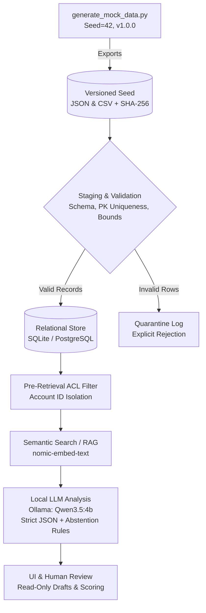

# ProspectAI — Synthetic CRM Data Pipeline & Scoring POC

> **DISCLAIMER:** Student prototype project (Equipe-01). All company names, financial metrics, contacts, and commercial signals in this repository are **100% synthetic/fictional** and do not represent real Givaudan internal data.

## Overview
This repository provides the reproducible synthetic data seed, validation pipeline, and governance report for **ProspectAI**—an AI-assisted sales intelligence prototype tailored for the Flavors & Fragrances (F&F) and Beauty sectors.

## Data Architecture Diagram



## Weighted Scoring Grid (100 Points)
Each company record is evaluated across five weighted criteria aligned with Product specifications:

| Criterion | Weight | Description |
|---|---|---|
| **Adéquation Givaudan** | 40% | Alignment with Taste & Wellbeing / Fragrance & Beauty portfolios |
| **Signaux détectés** | 20% | Recent hiring, product launches, partnerships, or M&A signals |
| **Taille et potentiel** | 15% | Revenue (M€), headcount, growth rate, and international footprint |
| **Innovation & R&D** | 15% | Active R&D, clean-label initiatives, and patent filings |
| **Date récente du signal** | 10% | Recency and freshness of the captured commercial signal |

## Quickstart

1. **Install dependencies:**
   ```bash
   pip install -r requirements.txt
   ```

2. **Generate the dataset, CSV export, and audit report:**
   ```bash
   python generate_mock_data.py
   ```

3. **Verify local Ollama models (for downstream RAG & extraction):**
   ```bash
   ollama list
   # Expected: qwen3.5:4b and nomic-embed-text:latest
   ```

## Generated Artifacts
- `data/givaudan_prospects_mock_v1.json`: Nested CRM objects ready for local LLM / RAG ingestion.
- `data/givaudan_prospects_mock_v1.csv`: Flattened tabular dataset (`UTF-8-SIG`) ready for Excel and Product review.
- `DATA_REPORT.md`: Automated data quality report containing SHA-256 checksums, distribution metrics, and validation status.